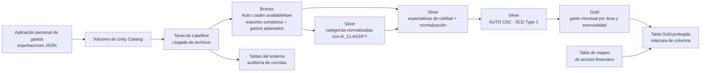

# Penny Lake: análisis de gastos personales en Databricks

Penny Lake convierte exportaciones de gastos personales en tablas Bronze, Silver
y Gold gobernadas con Unity Catalog. La pregunta de negocio es: **¿cuánto se
gasta cada mes por área de gasto y nivel de esencialidad?**

## Problema y datos

Los datos son exportaciones JSON acumulativas generadas por una aplicación
personal de gastos y cargadas por el usuario a un volumen de Unity Catalog. No
son datos de una empresa y los archivos fuente no se guardan en este repositorio.
Los exportes pueden contener montos en USD o CRC; la conversión de USD a CRC es
estimada con una tasa configurable.

## Arquitectura



## Componentes presentados

Se mantienen los cinco componentes obligatorios. O2 y O5 se presentan como
extensiones adicionales, no como reemplazos. El enunciado describe los
opcionales como reemplazos; esta elección conserva los componentes obligatorios
y agrega práctica, y conviene confirmarla con el docente.

| Requisito | Implementación y evidencia |
| --- | --- |
| V1 · Bronze | Auto Loader incremental, `schemaLocation`, `source_file_path` e idempotencia por lote. Mostrar en la UI los conteos de dos exportes, agrupados por archivo. |
| V2 · Silver | Tipos normalizados, filas inválidas descartadas por expectativas de calidad, deduplicación SCD Type 1, unión de categorías y métricas antes/después en [src/silver_metrics.py](src/silver_metrics.py). |
| C1 · Gold y calidad | Vista materializada de gasto mensual con tres expectativas de calidad. La salida literal del rechazo está en [src/penny_lake_etl/README.md](src/penny_lake_etl/README.md). |
| C2 · Orquestación | Tarea con Bronze, Silver, Gold y gobernanza; dependencias, reintentos y activador de llegada de archivos (File Arrival). [Una ejecución exitosa en producción](https://dbc-7c7fae20-e5c4.cloud.databricks.com/?o=7474656472211339#job/1005843869970972/run/434073181335631). |
| C3 · Gobernanza | Column mask con tabla de mapeo, grants mínimos para el lector, `SHOW GRANTS` y tags sensibles; detalles en [la documentación de transformaciones](src/penny_lake_etl/README.md). |
| C4 · CI/CD | Repositorio [público en GitHub](https://github.com/alkztro-95/penny_lake), solicitudes de cambios hacia `test` y `main`, integración continua y despliegue por bundle. La carpeta Git del espacio de trabajo se muestra desde Databricks. |
| C5 · Observabilidad y optimización | Consulta a tablas del sistema y clustering de `silver_expenses`; la evidencia SQL está en [05_observabilidad/C5_evidencia.sql](05_observabilidad/C5_evidencia.sql). Ver la decisión y su alcance más abajo. |
| O2 · Segunda identidad | Validación ejecutada desde la segunda cuenta: mostrar `current_user()`, la tabla Gold protegida y los accesos que esa identidad no tiene. |
| O5 · Ingesta por tandas | Auto Loader en flujo continuo con `availableNow`; cada llegada de archivos inicia una ejecución acotada compatible con cómputo sin servidor. |

## Decisiones de diseño

- Bronze conserva tanto el exporte completo como los gastos aplanados para
  mantener la procedencia y el contexto de cada lote.
- Silver normaliza los campos, descarta filas que incumplen reglas explicables,
  enriquece cada gasto con una categoría y conserva la última versión aceptada
  por `expense_id`.
- Gold agrega los gastos por mes, área y esencialidad; una tabla lectora separada
  aplica la máscara al monto financiero.
- El lector secundario está mapeado con `can_view_amount = false`. El principal
  de acceso completo al catálogo está mapeado con `true` para que pueda ver el
  monto en la tabla protegida.
- La tasa USD→CRC es una estimación, no una tasa histórica. El valor por defecto
  es 500 CRC/USD.
- Para C5 se eligió `silver_expenses`, administrada por la canalización
  declarativa, con `CLUSTER BY (expense_date, spending_area)` y optimización
  administrada por la canalización. En producción, `DESCRIBE DETAIL` y
  `DESCRIBE HISTORY` confirman esa configuración y el evento `CLUSTER BY`.
  Las tablas Bronze medidas en producción
  son mayores (`bronze_expense_exports`: 47.926 bytes;
  `bronze_expenses_raw`: 46.734 bytes; Silver: 33.164 bytes). Por eso, esta
  decisión no afirma que Silver sea la tabla más grande ni que exista una
  operación explícita `OPTIMIZE` sobre la tabla mayor.

## Cómo ejecutarlo

Requisitos locales: Databricks CLI, `uv` y acceso al espacio de trabajo. Instala las
dependencias y autentícate:

```bash
uv sync --dev
databricks auth login --host https://dbc-7c7fae20-e5c4.cloud.databricks.com
```

Para `dev`, inicializa el entorno y despliega el bundle:

```bash
databricks bundle validate -t dev
databricks bundle deploy -t dev --select jobs.setup_environment
databricks bundle run setup_environment -t dev
databricks bundle deploy -t dev
```

Después carga un JSON nuevo en el volumen
`/Volumes/<bronze_catalog>/landing/transactions_volume/`. El activador de llegada
de archivos (File Arrival) ejecuta el flujo Bronze → Silver → Gold → gobernanza.
`test` y `prod` se
promueven mediante solicitudes de cambios y GitHub Actions; las credenciales se guardan
en GitHub Environments, nunca en el repositorio.

Las pruebas locales se ejecutan con:

```bash
uv run python -m unittest discover -s tests -p 'test_*.py' -v
```

La documentación técnica detallada, el contrato JSON, las consultas de
evidencia y las instrucciones de gobernanza están en
[src/penny_lake_etl/README.md](src/penny_lake_etl/README.md) y
[05_observabilidad/C5_evidencia.sql](05_observabilidad/C5_evidencia.sql).

## Configuración del entorno

[databricks.yml](databricks.yml) proporciona los nombres de catálogo de cada
entorno a la [tarea de configuración](resources/setup_environment.job.yml). Su
[cuaderno](src/setup_environment.py) crea los siguientes objetos y concede
`ALL_PRIVILEGES` en los cuatro catálogos de cada entorno a
`catalog_full_access_principal` (por defecto, `alfredo.castro@ulatina.net`):

| Objeto | Desarrollo | Pruebas | Producción |
| --- | --- | --- | --- |
| Catálogo Bronze | `dev_penny_lake_01_bronze` | `test_penny_lake_01_bronze` | `prod_penny_lake_01_bronze` |
| Catálogo Silver | `dev_penny_lake_02_silver` | `test_penny_lake_02_silver` | `prod_penny_lake_02_silver` |
| Catálogo Gold | `dev_penny_lake_03_gold` | `test_penny_lake_03_gold` | `prod_penny_lake_03_gold` |
| Catálogo de gobernanza | `dev_penny_lake_04_governance` | `test_penny_lake_04_governance` | `prod_penny_lake_04_governance` |
| Esquema de capas | `expenses` en cada catálogo Bronze, Silver y Gold | `expenses` en cada catálogo Bronze, Silver y Gold | `expenses` en cada catálogo Bronze, Silver y Gold |
| Esquema de gobernanza | `governance` en el catálogo de gobernanza | `governance` en el catálogo de gobernanza | `governance` en el catálogo de gobernanza |
| Esquema de llegada | `landing` en el catálogo Bronze | `landing` en el catálogo Bronze | `landing` en el catálogo Bronze |
| Volumen administrado | Bronze `landing.transactions_volume` | Bronze `landing.transactions_volume` | Bronze `landing.transactions_volume` |
| Volumen de estado de Auto Loader | Bronze `landing.autoloader_state` | Bronze `landing.autoloader_state` | Bronze `landing.autoloader_state` |

La variable `catalog` existente corresponde al catálogo Bronze. La
[tarea de ingesta Bronze](src/bronze_ingest.py) usa Auto Loader y guarda
explícitamente el directorio de esquema en el volumen `autoloader_state`, junto
con un directorio separado para los puntos de control. Ejecuta
`setup_environment` para crear ese volumen antes de la tarea de ingesta.

### Opcional O5: ingesta por tandas en flujo continuo

La ruta Bronze ya cubre O5 sin un cuaderno que genere archivos de prueba:
la tarea `expense_refresh` espera archivos en el volumen de llegada y luego
`bronze_ingest.py` los lee con Auto Loader (`cloudFiles`) en flujo continuo.
Usa `availableNow=True` para procesar el lote disponible y finalizar. La llegada
de un archivo posterior inicia el siguiente lote, compatible con el cómputo
cómputo sin servidor. Este comportamiento se verifica en
[`tests/test_bronze_ingest.py`](tests/test_bronze_ingest.py).

Silver genera categorías distintas clasificadas con IA y luego procesa
`bronze_expenses_raw` en flujo continuo hacia `_int_expenses_expectations` para
normalizar campos, descartar filas que no cumplen las reglas de calidad declaradas
y calcular montos estimados en CRC. Una segunda tabla de flujo continuo enriquece
las filas aceptadas con las etiquetas de categoría. `silver_expenses` usa
AUTO CDC con SCD Type 1, clave `expense_id` y orden `exported_at`; conserva la
última versión aceptada de cada identificador, sin historial de cambios. Los
metadatos del archivo de origen y de la ingesta se conservan en Bronze. Como la
tabla Bronze sin procesar es de solo anexado y no genera eliminaciones, los
identificadores de gastos ausentes en exportaciones posteriores permanecen en
Silver; una exportación vacía no borra Silver. La conversión de USD usa la
variable del bundle `usd_to_crc_rate` (por defecto, 500 CRC/USD). Se conservan
los montos originales y la tasa aplicada. Para recalcular montos existentes
después de cambiar la tasa, se requiere una actualización completa.

Gold contiene la vista materializada `gold_monthly_spending`, que responde:
«¿Cuánto gastamos cada mes, en CRC estimados, por área de gasto y esencialidad?».
Incluye el conteo de transacciones y valida las etiquetas de mes, área y
esencialidad mediante reglas de calidad de la canalización; si aparece una fila inválida,
la actualización falla.

### Gobernanza de la tabla lectora Gold

Después de actualizar Gold, la tarea `expense_refresh` publica una tabla Delta
para lectores. La columna `total_amount_crc` usa una máscara de columna de
Unity Catalog respaldada por
``${governance_catalog}.governance.gold_amount_access_map`; el lector configurado
(`alkztro@hotmail.com` en dev, test y prod) recibe `NULL` en esa columna. Ese
lector no recibe permisos sobre la vista materializada sin máscara, ni acceso a
Bronze, Silver o la tabla de mapeo. De forma predeterminada, los montos se
enmascaran, salvo que la tabla de mapeo autorice explícitamente a un principal.
`catalog_full_access_principal` (`alfredo.castro@ulatina.net` por defecto) está
autorizado con `can_view_amount = true`, por lo que puede ver el monto en la
tabla protegida. Las columnas monetarias sensibles llevan las etiquetas
`sensitivity = sensitive` y `domain = financial`.

La tarea `apply_governance` aplica estos permisos después de actualizar Gold.
En test y prod, la tabla protegida y sus permisos se crean cuando
`expense_refresh` procesa datos correctamente; desplegar el bundle por sí solo
no ejecuta esa tarea.

### Requisitos

- El espacio de trabajo debe tener Unity Catalog y tareas de cuadernos con
  cómputo sin servidor disponibles.
- La identidad de ejecución de la tarea de configuración necesita `CREATE CATALOG`
  en el metastore. Para catálogos o esquemas existentes también necesita los
  permisos pertinentes: `USE CATALOG`, `USE SCHEMA`, `CREATE SCHEMA` y
  `CREATE VOLUME`.
- El almacenamiento administrado debe estar configurado para que los catálogos
  nuevos hereden una ubicación administrada. Si el metastore no tiene una raíz
  de almacenamiento administrado, un administrador debe configurar el
  almacenamiento o ampliar el cuaderno con valores `MANAGED LOCATION`
  explícitos por catálogo y los permisos de almacenamiento correspondientes.
- Los parámetros de nombres de objetos aceptan letras, números y guiones bajos;
  deben comenzar con una letra o un guion bajo y pueden tener hasta 255 caracteres.
- El bundle completo compila un paquete wheel de Python con `uv`; instala `uv`
  antes del despliegue.

### Desplegar y luego ejecutar la configuración

Ejecuta estos comandos desde la raíz del proyecto. En un entorno nuevo,
despliega primero solo la tarea de configuración para que el despliegue de la
canalización no dependa de catálogos que aún no existen. El despliegue selectivo
requiere una versión de CLI compatible con `bundle deploy --select` (la versión
instalada, v1.11.0, lo admite).

```bash
# Desarrollo
databricks bundle validate -t dev
databricks bundle deploy -t dev --select jobs.setup_environment
databricks bundle run setup_environment -t dev
databricks bundle deploy -t dev

# Producción: ejecutar por separado cuando corresponda
databricks bundle validate -t prod
databricks bundle deploy -t prod --select jobs.setup_environment
databricks bundle run setup_environment -t prod
databricks bundle deploy -t prod
```

Cada destino despliega su propia tarea de configuración. No tiene una
programación; ejecútala explícitamente. Sus parámetros se pasan
automáticamente a los widgets del cuaderno. Todas las creaciones usan
`IF NOT EXISTS`: repetir la ejecución no reemplaza objetos ni elimina datos, y
se puede reintentar una configuración parcial fallida. Los errores de permisos
y almacenamiento hacen que la tarea falle; no se ocultan. Este cuaderno no
reconcilia la propiedad, los permisos, las ubicaciones de almacenamiento ni los
tipos de los objetos existentes. Los permisos para otras identidades de
pipelines o de BI no se crean automáticamente.

Después de la configuración, carga archivos JSON en:

```text
/Volumes/dev_penny_lake_01_bronze/landing/transactions_volume/
/Volumes/prod_penny_lake_01_bronze/landing/transactions_volume/
```

El despliegue por sí solo no ejecuta la configuración ni carga archivos. La tarea
de actualización de gastos ejecuta Bronze, Silver, Gold y la publicación de
gobernanza en el orden de sus dependencias. El activador de llegada de archivos
está activo; la tarea también se puede iniciar manualmente. Los
catálogos, esquemas, volúmenes y sus datos no son recursos administrados por el
bundle: `bundle destroy` no elimina los objetos creados por el cuaderno.

## Flujo de despliegue por ramas de Git

El flujo previsto de promoción es:

| Evento de GitHub | Destino del bundle |
| --- | --- |
| Despliegue manual desde la carpeta Git del espacio de trabajo de Databricks | `dev` |
| Integración de una solicitud de cambios en `test` | `test` |
| Integración de una solicitud de cambios de `test` en `main` | `prod` |

El [flujo de integración continua](.github/workflows/ci.yml) ejecuta pruebas
unitarias que no dependen del espacio de trabajo en solicitudes de cambios hacia
`test` y `main`. El
[flujo de despliegue](.github/workflows/deploy.yml) usa autenticación OAuth de
Databricks entre máquinas (M2M) y despliega únicamente en `test` y `prod`.
Requiere que la variable de Actions del repositorio
`DATABRICKS_DEPLOYMENTS_ENABLED` tenga el valor `true`; mantenla desactivada
hasta configurar y verificar las credenciales de los entornos de GitHub y los
permisos de las entidades de servicio.

Configura en GitHub Actions los entornos `test` y `prod`. En cada entorno,
establece `DATABRICKS_HOST` con la URL del espacio de trabajo y `DATABRICKS_CLIENT_ID`
con el ID de la aplicación de Databricks correspondiente. Agrega en cada
entorno un secreto llamado `DATABRICKS_CLIENT_SECRET` con el secreto OAuth de
esa entidad de servicio. Nunca agregues ese secreto al repositorio, a los
archivos de flujo de trabajo ni al chat.

| Entorno | Entidad de servicio | ID de aplicación |
| --- | --- | --- |
| `test` | `sp-dab-dev` | `cb2f526a-1a03-47da-a4f6-30729febe372` |
| `prod` | `sp-dab-prod` | `76668225-6dad-4f36-bc24-e9b41f811953` |

Los flujos de despliegue de `test` y `prod` despliegan y ejecutan
`setup_environment` antes de desplegar las canalizaciones. Esa tarea crea
catálogos,
esquemas y volúmenes, y luego concede `ALL_PRIVILEGES` en esos cuatro catálogos
a `catalog_full_access_principal`. El mismo permiso se concede en `dev` cuando
se ejecuta manualmente su tarea de configuración. La identidad de configuración
necesita `CREATE_CATALOG` en el metastore y permiso para conceder acceso a los
catálogos que crea: `sp-dab-dev` para `dev` y `test`, y `sp-dab-prod` para
`prod`. La edición gratuita (Free Edition) no ofrece acceso a la consola de cuenta
(Account Console) ni a las API de cuenta,
por lo que este flujo usa secretos OAuth M2M en lugar de políticas de
federación OIDC de GitHub. Agrega la variable de Actions del repositorio
`DATABRICKS_DEPLOYMENTS_ENABLED=true` solo después de verificar el secreto, el
host, el ID de cliente y los permisos requeridos de cada entorno.

Para desplegar `dev` manualmente en Databricks, sincroniza la rama deseada en la
carpeta Git del espacio de trabajo, abre el archivo raíz `databricks.yml`,
selecciona el icono Deployments (Despliegues), elige el destino `dev` y
despliega. La interfaz del bundle realiza el despliegue con tu usuario actual de
Databricks, que necesita los permisos requeridos del espacio de trabajo y de
Unity Catalog. Luego ejecuta la tarea `setup_environment` desde los recursos
del bundle o desde Workflows → Jobs (Flujos de trabajo → Tareas) para inicializar
los catálogos y permisos. Los nombres de tareas y canalizaciones incluyen
el destino seleccionado (`dev`, `test` o `prod`). El destino `dev` permanece en
`databricks.yml`, pero no requiere un entorno de GitHub.

### Probar la configuración sin conexión al espacio de trabajo

Las pruebas de configuración simulan los widgets del cuaderno y Spark SQL; no
requieren cómputo remoto ni dependencias de terceros:

```bash
python3 -m unittest discover -s tests -p 'test_setup_environment.py' -v
```

## Ingesta de gastos

Carga en el volumen de desarrollo indicado una exportación acumulativa
representativa con un nombre de archivo `.json` único; luego despliega de forma
selectiva y ejecuta:

```bash
databricks bundle deploy -t dev --select jobs.expense_refresh,pipelines.penny_lake_silver
databricks bundle run expense_refresh -t dev
```

Consulta la [documentación de la canalización](src/penny_lake_etl/README.md) para ver
el contrato JSON, las tablas de salida Bronze, las verificaciones de calidad
de datos y el comportamiento de las exportaciones acumulativas. El cuaderno de
ejemplo anterior y los ejemplos del paquete siguen en el repositorio, pero el
la tarea de actualización de gastos no los ejecuta.

Las pruebas simuladas de la canalización no requieren cómputo remoto:

```bash
python3 -m unittest discover -s tests -p 'test_bronze_ingest.py' -v
```

Estas pruebas verifican la configuración y la conexión de las transformaciones,
no la ejecución real de Spark. Las tablas Bronze conservan la exportación
completa, incluidas las matrices vacías, además de las filas de gastos
aplanadas; ambas contienen `source_file_path`. Agrupa
`bronze_expense_exports` por `source_file_path` para mostrar que cada archivo
de entrada se ingirió una sola vez.

La tarea de actualización ejecuta Bronze y luego Silver. El
[cuaderno de métricas](src/silver_metrics.py) contiene celdas de métricas antes
y después. Silver conserva la última versión aceptada de cada `expense_id`;
consulta todas las filas de `silver_expenses` para ver el estado actual de SCD
Type 1. Los identificadores ausentes en exportaciones posteriores permanecen
porque la tabla Bronze sin procesar solo admite anexados. Lee la
[documentación del estado actual de Silver](src/penny_lake_etl/README.md#silver-current-state)
antes de cargar exportaciones adicionales.

Ejecuta las pruebas simuladas de Bronze y Silver sin cómputo remoto:

```bash
python3 -m unittest discover -s tests -p 'test_*pipeline.py' -v
```

## C5: Observabilidad y optimización

La consulta independiente del destino a las tablas del sistema en
[05_observabilidad/C5_evidencia.sql](05_observabilidad/C5_evidencia.sql)
busca las ejecuciones de actualización de gastos de los destinos desplegados
del bundle, uniendo `system.lakeflow.jobs` con
`system.lakeflow.job_run_timeline`. Los registros de las tablas del sistema
pueden tardar hasta una hora en aparecer.

El clustering líquido está declarado en la tabla de flujo continuo `silver_expenses`,
administrada por SDP, en
[src/penny_lake_etl/transformations/silver_expenses.sql](src/penny_lake_etl/transformations/silver_expenses.sql),
con `expense_date` y `spending_area`. La misma definición establece
`pipelines.autoOptimize.managed = true`, para que la canalización propietaria
administre la optimización. El archivo SQL de C5 incluye instrucciones
parametrizadas `DESCRIBE DETAIL` y `DESCRIBE HISTORY` para cada destino.

La tabla más grande medida en todo el proyecto de test fue en realidad la tabla
Bronze `bronze_expense_exports` (52.731 bytes), escrita por la tarea de ingesta
Bronze independiente y no por un SDP. Como se eligió mantener la optimización
declarativa en la canalización existente, este cambio aplica clustering a
`silver_expenses`; no afirma que Silver sea la tabla más grande del proyecto.
Para aplicar la misma declaración a la tabla Bronze, habría que trasladar la
ingesta Bronze a un SDP.

En test, antes de la optimización, `DESCRIBE DETAIL` midió
`bronze_expense_exports` en 52.731 bytes, frente a 51.043 bytes para
`bronze_expenses_raw` y 35.218 bytes para `silver_expenses`. Después del
clustering y la optimización, `DESCRIBE DETAIL` informó
`clusteringColumns = ["exportedAt"]`, un archivo y 30.528 bytes.
`DESCRIBE HISTORY` registró `CLUSTER BY` en la versión 5 y `OPTIMIZE FULL` en la
versión 6; el `OPTIMIZE` posterior compactó tres archivos en uno. La consulta
Lakeflow devolvió la ejecución de actualización de test `546572501279640` con
estado `SUCCEEDED`. El conjunto de datos es pequeño, así que esto demuestra la
operación Bronze anterior y su evidencia, no una mejora significativa de
rendimiento. La evidencia de Silver en producción se documenta a continuación.

### Evidencia en producción

En producción, `DESCRIBE DETAIL` informó 47.926 bytes para
`bronze_expense_exports`, 46.734 bytes para `bronze_expenses_raw` y 33.164
bytes para `silver_expenses`. Por lo tanto, Silver no es la mayor de las tablas
medidas. El historial de producción registra `CLUSTER BY` en la versión 2 y un
`MERGE` posterior, pero no una operación explícita `OPTIMIZE`. Esta evidencia
documenta la optimización de Silver administrada por la canalización y no afirma
que cumpla literalmente con el requisito de aplicar clustering y optimizar la
tabla más grande.
