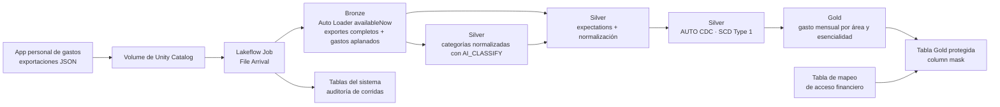

# Penny Lake: análisis de gastos personales en Databricks

Penny Lake convierte exportaciones de gastos personales en tablas Bronze, Silver
y Gold gobernadas con Unity Catalog. La pregunta de negocio es: **¿cuánto se
gasta cada mes por área de gasto y nivel de esencialidad?**

## Problema y datos

Los datos son exportaciones JSON acumulativas generadas por una aplicación
personal de gastos y cargadas por el usuario a un Volume de Unity Catalog. No
son datos de una empresa y los archivos fuente no se guardan en este repositorio.
Los exportes pueden contener montos en USD o CRC; la conversión de USD a CRC es
estimada con una tasa configurable.

## Arquitectura



## Componentes presentados

Se mantienen los cinco componentes obligatorios. O2 y O5 se presentan como
extensiones adicionales, no como reemplazos. El enunciado describe los
opcionales como reemplazos; esta elección conserva los componentes obligatorios
y agrega práctica, y conviene confirmarla con el docente.

| Requisito | Implementación y evidencia |
| --- | --- |
| V1 · Bronze | Auto Loader incremental, `schemaLocation`, `source_file_path` e idempotencia por lote. Mostrar en la UI los conteos de dos exportes, agrupados por archivo. |
| V2 · Silver | Tipos normalizados, filas inválidas descartadas por expectations, deduplicación SCD Type 1, join de categorías y métricas antes/después en [src/silver_metrics.py](src/silver_metrics.py). |
| C1 · Gold y calidad | Vista materializada de gasto mensual con tres expectations. La salida literal del rechazo está en [src/penny_lake_etl/README.md](src/penny_lake_etl/README.md). |
| C2 · Orquestación | Job con Bronze, Silver, Gold y gobernanza; dependencias, reintentos y trigger File Arrival. [Una corrida exitosa en Prod](https://dbc-7c7fae20-e5c4.cloud.databricks.com/?o=7474656472211339#job/1005843869970972/run/434073181335631). |
| C3 · Gobernanza | Column mask con tabla de mapeo, grants mínimos para el lector, `SHOW GRANTS` y tags sensibles; detalles en [la documentación de transformaciones](src/penny_lake_etl/README.md). |
| C4 · CI/CD | Repositorio [público en GitHub](https://github.com/alkztro-95/penny_lake), PRs a `test` y `main`, CI y despliegue por Bundle. El workspace Git folder se muestra desde Databricks. |
| C5 · Observabilidad y optimización | Consulta a tablas del sistema y clustering de `silver_expenses`; la evidencia SQL está en [05_observabilidad/C5_evidencia.sql](05_observabilidad/C5_evidencia.sql). Ver la decisión y su alcance más abajo. |
| O2 · Segunda identidad | Validación ejecutada desde la segunda cuenta: mostrar `current_user()`, la tabla Gold protegida y los accesos que esa identidad no tiene. |
| O5 · Ingesta por tandas | Auto Loader en streaming con `availableNow`; cada llegada de archivos dispara una corrida acotada compatible con serverless. |

## Decisiones de diseño

- Bronze conserva tanto el exporte completo como los gastos aplanados para
  mantener la procedencia y el contexto de cada lote.
- Silver normaliza los campos, descarta filas que incumplen reglas explicables,
  enriquece cada gasto con una categoría y conserva la última versión aceptada
  por `expense_id`.
- Gold agrega los gastos por mes, área y esencialidad; una tabla lectora separada
  aplica la máscara al monto financiero.
- El lector secundario está mapeado con `can_view_amount = false`. El principal
  de acceso completo al catálogo está mapeado con `true` para que pueda ver el
  monto en la tabla protegida.
- La tasa USD→CRC es una estimación, no una tasa histórica. El valor por defecto
  es 500 CRC/USD.
- Para C5 se eligió `silver_expenses`, administrada por el pipeline declarativo,
  con `CLUSTER BY (expense_date, spending_area)` y optimización administrada por
  el pipeline. En Prod, `DESCRIBE DETAIL` y `DESCRIBE HISTORY` confirman esa
  configuración y el evento `CLUSTER BY`. Las tablas Bronze medidas en Prod
  son mayores (`bronze_expense_exports`: 47.926 bytes;
  `bronze_expenses_raw`: 46.734 bytes; Silver: 33.164 bytes). Por eso, esta
  decisión no afirma que Silver sea la tabla más grande ni que exista una
  operación explícita `OPTIMIZE` sobre la tabla mayor.

## Cómo ejecutarlo

Requisitos locales: Databricks CLI, `uv` y acceso al workspace. Instala las
dependencias y autentícate:

```bash
uv sync --dev
databricks auth login --host https://dbc-7c7fae20-e5c4.cloud.databricks.com
```

Para `dev`, inicializa el entorno y despliega el Bundle:

```bash
databricks bundle validate -t dev
databricks bundle deploy -t dev --select jobs.setup_environment
databricks bundle run setup_environment -t dev
databricks bundle deploy -t dev
```

Después carga un JSON nuevo en el Volume
`/Volumes/<bronze_catalog>/landing/transactions_volume/`. El trigger File Arrival
ejecuta el flujo Bronze → Silver → Gold → gobernanza. `test` y `prod` se
promueven mediante pull requests y GitHub Actions; las credenciales se guardan
en GitHub Environments, nunca en el repositorio.

Las pruebas locales se ejecutan con:

```bash
uv run python -m unittest discover -s tests -p 'test_*.py' -v
```

La documentación técnica detallada, el contrato JSON, las consultas de
evidencia y las instrucciones de gobernanza están en
[src/penny_lake_etl/README.md](src/penny_lake_etl/README.md) y
[05_observabilidad/C5_evidencia.sql](05_observabilidad/C5_evidencia.sql).

## Configuración del entorno

[databricks.yml](databricks.yml) supplies environment-specific catalog names to
the [setup job](resources/setup_environment.job.yml). Its
[notebook](src/setup_environment.py) creates the following objects and grants
`ALL_PRIVILEGES` on each environment's four catalogs to
`catalog_full_access_principal` (default `alfredo.castro@ulatina.net`):

| Object | Development | Test | Production |
| --- | --- | --- | --- |
| Bronze catalog | `dev_penny_lake_01_bronze` | `test_penny_lake_01_bronze` | `prod_penny_lake_01_bronze` |
| Silver catalog | `dev_penny_lake_02_silver` | `test_penny_lake_02_silver` | `prod_penny_lake_02_silver` |
| Gold catalog | `dev_penny_lake_03_gold` | `test_penny_lake_03_gold` | `prod_penny_lake_03_gold` |
| Governance catalog | `dev_penny_lake_04_governance` | `test_penny_lake_04_governance` | `prod_penny_lake_04_governance` |
| Layer schema | `expenses` in each Bronze, Silver, and Gold catalog | `expenses` in each Bronze, Silver, and Gold catalog | `expenses` in each Bronze, Silver, and Gold catalog |
| Governance schema | `governance` in the governance catalog | `governance` in the governance catalog | `governance` in the governance catalog |
| Landing schema | `landing` in the bronze catalog | `landing` in the bronze catalog | `landing` in the bronze catalog |
| Managed Volume | Bronze `landing.transactions_volume` | Bronze `landing.transactions_volume` | Bronze `landing.transactions_volume` |
| Auto Loader state Volume | Bronze `landing.autoloader_state` | Bronze `landing.autoloader_state` | Bronze `landing.autoloader_state` |

The existing `catalog` variable is the bronze catalog. The
[bronze ingestion job](src/bronze_ingest.py) uses Auto Loader with the schema
directory explicitly stored in the `autoloader_state` Volume, plus a separate
checkpoint directory in that Volume. Run `setup_environment` to create the state
Volume before the ingestion job.

### Optional O5: batched streaming ingestion

The Bronze path already covers O5 without a synthetic file-writer notebook:
the `expense_refresh` job waits for files in the landing Volume, then
`bronze_ingest.py` reads them with Auto Loader (`cloudFiles`) in streaming mode
and uses `availableNow=True` to process the available batch and terminate. A
later file arrival starts the next batch, which is compatible with serverless
compute. The behavior is asserted in
[`tests/test_bronze_ingest.py`](tests/test_bronze_ingest.py).

Silver builds distinct AI-classified categories, then streams
`bronze_expenses_raw` into `_int_expenses_expectations` to normalize fields,
drop rows that fail the declared expectations, and calculate estimated CRC
amounts. A second streaming table enriches accepted rows with category labels.
`silver_expenses` uses AUTO CDC SCD Type 1 keyed by `expense_id`, ordered by
`exported_at`; it keeps the latest accepted version seen for each ID, without
retaining change history. Source file and ingestion metadata stay in Bronze.
Because Bronze raw is append-only and does not emit deletes, expense IDs absent
from later exports remain in Silver; an empty export does not clear Silver.
USD conversion uses the `usd_to_crc_rate` bundle variable (default 500 CRC/USD).
Original amounts and the applied rate are retained. A full refresh is required
to recompute existing amounts after changing the rate.

Gold contains the `gold_monthly_spending` materialized view, which answers:
"How much are we spending in estimated CRC each month, by spending area and
essentiality?" It includes transaction counts and enforces valid month, area,
and essentiality labels with pipeline expectations that fail an update if a
bad row appears.

### Gold reader governance

The `expense_refresh` job publishes a Delta reader table after Gold refresh.
Its `total_amount_crc` column uses a Unity Catalog column mask backed by
`${governance_catalog}.governance.gold_amount_access_map`; the configured
reader (`alkztro@hotmail.com` in dev, test, and prod) receives `NULL` for that column. The
unmasked materialized view remains ungranted to that reader. The reader also
gets no Bronze, Silver, or mapping-table access. Access defaults to masked
unless a principal is explicitly allowed by the mapping table. The configured
`catalog_full_access_principal` (`alfredo.castro@ulatina.net` by default) is
explicitly mapped with `can_view_amount = true`, so it sees the amount in the
protected reader table. Sensitive monetary columns are tagged with
`sensitivity = sensitive` and `domain = financial`.

The `apply_governance` task applies these reader grants after Gold refresh. In
test and prod, the protected reader table and its grants are created when
`expense_refresh` successfully processes data; deploying the bundle alone does
not run that job.

### Requirements

- Unity Catalog and serverless notebook jobs must be available in the workspace.
- The setup job's run identity needs `CREATE CATALOG` on the metastore. For existing
  catalogs/schemas it also needs the relevant `USE CATALOG`, `USE SCHEMA`,
  `CREATE SCHEMA`, and `CREATE VOLUME` privileges.
- Managed storage must be configured so new catalogs can inherit a managed
  location. If the metastore has no managed storage root, an administrator must
  configure storage or the notebook must be extended with explicit per-catalog
  `MANAGED LOCATION` values and the corresponding storage privileges.
- Object-name parameters accept letters, digits, and underscores, starting with
  a letter or underscore, up to 255 characters.
- The full bundle builds a Python wheel using `uv`; install `uv` before deploying.

### Deploy, then run setup

Run these commands from the project root. On a new environment, selectively
deploy the setup job first so pipeline deployment does not depend on catalogs
that have not yet been created. Selective deployment requires a CLI version
supporting `bundle deploy --select` (the installed v1.11.0 supports it).

```bash
# Development
databricks bundle validate -t dev
databricks bundle deploy -t dev --select jobs.setup_environment
databricks bundle run setup_environment -t dev
databricks bundle deploy -t dev

# Production: run separately when ready
databricks bundle validate -t prod
databricks bundle deploy -t prod --select jobs.setup_environment
databricks bundle run setup_environment -t prod
databricks bundle deploy -t prod
```

Each target deploys its own setup job. It has no schedule; run it explicitly.
The job parameters are automatically passed to the notebook's widgets.
Every creation uses `IF NOT EXISTS`: reruns do not replace objects or delete
data, and a failed partial setup can be retried. Permission and storage errors
fail the job rather than being suppressed. Existing objects' ownership,
permissions, storage locations, and types are not reconciled by this notebook.
Grants to other pipeline or BI identities are not created automatically.

After setup, upload JSON files to:

```text
/Volumes/dev_penny_lake_01_bronze/landing/transactions_volume/
/Volumes/prod_penny_lake_01_bronze/landing/transactions_volume/
```

Deployment alone does not run setup or upload files. The expense refresh job
runs Bronze, Silver, Gold, and the governance publication task in dependency
order. Its file-arrival trigger is active; it can also be started manually.
Catalogs, schemas, Volumes, and their data are not bundle-managed resources:
`bundle destroy` does not remove the objects created by the notebook.

## Git branch deployment flow

The intended promotion flow is:

| GitHub event | Bundle target |
| --- | --- |
| Manual deployment from the Databricks workspace Git folder | `dev` |
| Merge a pull request into `test` | `test` |
| Merge a pull request from `test` into `main` | `prod` |

The [CI workflow](.github/workflows/ci.yml) runs workspace-independent unit
tests on pull requests to `test` and `main`. The
[deployment workflow](.github/workflows/deploy.yml) uses Databricks OAuth
machine-to-machine (M2M) authentication and deploys only to `test` and `prod`.
It requires the repository Actions variable
`DATABRICKS_DEPLOYMENTS_ENABLED` to equal `true`; keep it disabled until the
GitHub environment credentials and service principal permissions are configured
and verified.

Configure GitHub Actions Environments named `test` and `prod`. In each
environment set `DATABRICKS_HOST` to the workspace URL and `DATABRICKS_CLIENT_ID`
to the matching Databricks application ID. Add an environment secret named
`DATABRICKS_CLIENT_SECRET` containing that service principal's OAuth secret.
Never add the secret to the repository, workflow files, or chat.

| Environment | Service principal | Application ID |
| --- | --- | --- |
| `test` | `sp-dab-dev` | `cb2f526a-1a03-47da-a4f6-30729febe372` |
| `prod` | `sp-dab-prod` | `76668225-6dad-4f36-bc24-e9b41f811953` |

The `test` and `prod` deployment workflows deploy and run `setup_environment`
before deploying pipelines. That job creates catalogs, schemas, and Volumes,
then grants `ALL_PRIVILEGES` on those four catalogs to
`catalog_full_access_principal`. The same grant is applied in `dev` when its
setup job is run manually. The setup identity needs `CREATE_CATALOG` on the
metastore and permission to grant access on the catalogs it creates:
`sp-dab-dev` for `dev`/`test`, and `sp-dab-prod` for `prod`. Free Edition does
not provide Account Console access or account-level APIs, so this workflow uses
OAuth M2M secrets instead of GitHub OIDC federation policies.
Then add the repository Actions variable
`DATABRICKS_DEPLOYMENTS_ENABLED=true` only after verifying each environment's
secret, host, client ID, and required grants.

To deploy `dev` manually in Databricks, sync the desired branch in the
workspace Git folder, open its root `databricks.yml`, select the Deployments
icon, choose the `dev` target, and deploy. The bundle UI executes the deployment
as your current Databricks user, so that user needs the required workspace and
Unity Catalog permissions. Then run the bundle's `setup_environment` job from
the bundle resources or Workflows → Jobs to initialize catalogs and grants. Job
and pipeline names include the selected target (`dev`, `test`, or `prod`). The
`dev` target remains in `databricks.yml`, but does not require a GitHub
Environment.

### Test setup without a workspace connection

The setup tests use mocked notebook widgets and Spark SQL, with no remote
compute or third-party dependencies:

```bash
python3 -m unittest discover -s tests -p 'test_setup_environment.py' -v
```

## Expense ingestion

Upload a representative cumulative expense export with a unique `.json` filename
to the development Volume above, then selectively deploy and run:

```bash
databricks bundle deploy -t dev --select jobs.expense_refresh,pipelines.penny_lake_silver
databricks bundle run expense_refresh -t dev
```

See the [pipeline documentation](src/penny_lake_etl/README.md) for the JSON contract,
bronze output tables, data-quality checks, and cumulative-export semantics.
The old sample notebook and package examples remain locally but are not run by
the expense refresh job.

The mocked pipeline tests require no remote compute:

```bash
python3 -m unittest discover -s tests -p 'test_bronze_ingest.py' -v
```

These tests verify configuration and transformation wiring, not actual Spark
execution. The bronze tables retain the complete export, including empty arrays,
and flattened expense rows; both include `source_file_path`. Check
`bronze_expense_exports` grouped by `source_file_path` to show each input file
was ingested once.

The refresh job now runs Bronze followed by Silver. The
[metrics notebook](src/silver_metrics.py) has a before/after metrics cell pair.
Silver keeps the latest accepted version seen for each `expense_id`; query all
rows in `silver_expenses` for the SCD Type 1 current state. IDs absent from later
exports remain because Bronze raw is append-only. Read the
[Silver current-state documentation](src/penny_lake_etl/README.md#silver-current-state)
before uploading additional exports.

Run the bronze and silver mocked tests without remote compute:

```bash
python3 -m unittest discover -s tests -p 'test_*pipeline.py' -v
```

## C5: Observability and optimization

The target-independent system-table query in
[05_observabilidad/C5_evidencia.sql](05_observabilidad/C5_evidencia.sql)
finds expense-refresh runs for deployed bundle targets by joining
`system.lakeflow.jobs` to `system.lakeflow.job_run_timeline`. System-table
records can take up to an hour to appear.

Liquid clustering is declared on the SDP-managed `silver_expenses` streaming
table in
[src/penny_lake_etl/transformations/silver_expenses.sql](src/penny_lake_etl/transformations/silver_expenses.sql),
using `expense_date` and `spending_area`. The same table definition sets
`pipelines.autoOptimize.managed = true`, allowing the owning pipeline to manage
optimization. The C5 SQL file includes parameterized `DESCRIBE DETAIL` and
`DESCRIBE HISTORY` statements for each target.

The largest table measured across the whole test project was actually Bronze
`bronze_expense_exports` (52,731 bytes), which is written by the separate Bronze
ingestion Job rather than an SDP. Per your choice to keep optimization
declarative in the existing pipeline, this change clusters `silver_expenses`
instead; it does not claim that Silver was the largest table across the entire
project. Moving Bronze ingestion into an SDP would be needed to apply the same
declaration to that Bronze table.

In test, the pre-optimization `DESCRIBE DETAIL` measured
`bronze_expense_exports` at 52,731 bytes, compared with 51,043 bytes for
`bronze_expenses_raw` and 35,218 bytes for `silver_expenses`. After clustering
and optimization, `DESCRIBE DETAIL` reported `clusteringColumns = ["exportedAt"]`,
one file, and 30,528 bytes. `DESCRIBE HISTORY` recorded `CLUSTER BY` at version 5
and `OPTIMIZE FULL` at version 6; the subsequent `OPTIMIZE` compacted three files
into one. The Lakeflow query returned the test refresh run
`546572501279640` with `SUCCEEDED`. The dataset is small, so this demonstrates
the previous Bronze test operation and its evidence rather than a meaningful
performance improvement. Production Silver evidence is documented below.

@@
In Prod, `DESCRIBE DETAIL` reported 47,926 bytes for
`bronze_expense_exports`, 46,734 bytes for `bronze_expenses_raw`, and 33,164
bytes for `silver_expenses`. The Silver table is therefore not the largest of
the measured tables. Its production history records `CLUSTER BY` at version 2
and a later `MERGE`, but no explicit `OPTIMIZE` operation. This evidence records
the implemented pipeline-managed Silver optimization and does not claim that it
meets the rubric's literal request to cluster and optimize the largest table.
